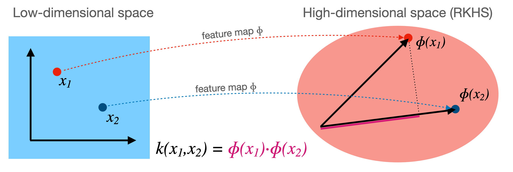

  <a href="#lang-en">English</a> · <strong>فارسی</strong>

# روش کرنل (ترفند کرنل)

## 1. مقدمه

بسیاری از الگوریتم‌های یادگیری ماشین، از جمله رگرسیون خطی، رگرسیون لجستیک، تحلیل مؤلفه‌های اصلی
(PCA) و دسته‌بندهای خطی (مثل پرسپترون یا ماشین‌های بردار پشتیبان خطی)، بر رابطه‌های خطی میان
نقطه‌های داده تکیه دارند. این الگوریتم‌ها وقتی خوب کار می‌کنند که داده خطی‌جداپذیر باشد یا با
تابع‌های خطی به‌قدر کافی مدل شود. ولی بسیاری از مسئله‌های دنیای واقعی ساختارهای ناخطی پیچیده‌ای
دارند که مدل‌های خطی نمی‌توانند به‌درستی بگیرند.

**روش کرنل** (که اغلب **ترفند کرنل** نامیده می‌شود) راهی توانمند برای به‌کارگیری الگوریتم‌های خطی
روی دادهٔ ناخطی می‌دهد. ایدهٔ اصلی نگاشت داده به **فضای ویژگی** ($\mathcal{F}$) با ابعاد بالاتر است
که در آن داده خطی‌جداپذیر می‌شود یا مدل‌سازی خطی‌اش آسان‌تر است. «ترفند» این است که این نگاشت را
می‌توان *به‌صورت ضمنی* با یک **تابع کرنل** انجام داد، بدون آنکه هرگز نیاز باشد مختصات نقطه‌های داده
در فضای ویژگی پرابعاد (و شاید بی‌نهایت‌بعد) صریحاً حساب شود. این کار بار محاسباتی نگاشت صریح را دور
می‌زند.

> **توجه:** ترفند کرنل، که با نام‌های *[روش کرنل](https://en.wikipedia.org/wiki/Kernel_method)* یا
> *ماشین‌های کرنلی* هم شناخته می‌شود، دسته‌ای از الگوریتم‌ها برای تحلیل الگو است که در آن‌ها از
> دسته‌بندهای خطی برای حل مسئله‌های ناخطی استفاده می‌شود. این روش‌ها با
> *[کرنل‌سازی](https://en.wikipedia.org/wiki/Kernelization)* فرق دارند؛ آن یکی تکنیکی برای طراحی
> الگوریتم‌های کارآمد است که کارآمدی‌اش را از یک مرحلهٔ پیش‌پردازش می‌گیرد که در آن ورودی الگوریتم با
> ورودی کوچک‌تری به نام «کرنل» جایگزین می‌شود.

## 2. محدودیت‌های مدل‌های خطی

یک مسئلهٔ دسته‌بندی دودویی را در نظر بگیرید. مدل خطی می‌کوشد **ابرصفحه‌ای** بیابد که نقطه‌های دادهٔ
دسته‌های مختلف را جدا کند.
*   در فضای دوبعدی، ابرصفحه یک خط است ($\mathbf{w}^T\mathbf{x} + b = w_1 x_1 + w_2 x_2 + b = 0$).
*   در فضای سه‌بعدی، ابرصفحه یک صفحه است ($w_1 x_1 + w_2 x_2 + w_3 x_3 + b = 0$).
*   در فضای $p$-بعدی، ابرصفحه زیرفضایی $(p-1)$-بعدی است.

اگر چنین ابرصفحهٔ جداکننده‌ای وجود داشته باشد، داده **خطی‌جداپذیر** نامیده می‌شود. ولی اگر داده ساختار
ناخطی داشته باشد، مثل مسئلهٔ کلاسیک XOR یا دایره‌های هم‌مرکز، هیچ ابرصفحهٔ واحدی نمی‌تواند دسته‌ها را
در فضای ورودی اصلی درست جدا کند.

## 3. نگاشت ویژگی

برای سر و کار داشتن با دادهٔ ناخطی، می‌توانیم داده را به فضای ویژگی تازه و پرابعادتری ببریم که در آن
شاید خطی‌جداپذیر شود. این کار با یک **تابع نگاشت** انجام می‌شود که با $\phi$ نشان می‌دهیم:

$$ \phi: \mathcal{X} \to \mathcal{F} $$

*   $\mathcal{X}$: فضای ورودی اصلی (مثلاً $\mathbb{R}^p$).
*   $\mathcal{F}$: فضای ویژگی، معمولاً با ابعادی بسیار بیشتر از $\mathcal{X}$ (مثلاً $\mathbb{R}^d$ که
    $d \gg p$، یا حتی بی‌نهایت‌بعد).

## 4. ترفند کرنل

توان روش کرنل در این مشاهده نهفته است که بسیاری از الگوریتم‌های خطی را می‌توان چنان صورت‌بندی کرد که
فقط به **ضرب داخلی** میان نقطه‌های داده ($\mathbf{x}_i^T \mathbf{x}_j$) نیاز داشته باشند. نمونه‌ها:
پرسپترون (در صورت دوگان)، رگرسیون لجستیک (صورت دوگان)، PCA و ماشین‌های بردار پشتیبان.

اگر از نگاشت ویژگی $\phi$ استفاده کنیم، این الگوریتم‌ها باید ضرب داخلی را در فضای ویژگی پرابعاد حساب
کنند: $\phi(\mathbf{x}_i)^T \phi(\mathbf{x}_j)$. حساب کردن صریح $\phi(\mathbf{x})$ می‌تواند از نظر
محاسباتی بسیار پرهزینه باشد، به‌ویژه اگر $\mathcal{F}$ ابعاد بسیار بالا یا بی‌نهایت داشته باشد.

**ترفند کرنل** این محاسبهٔ صریح را دور می‌زند. یک **تابع کرنل** $K$ تعریف می‌کنیم که ضرب داخلی را در
فضای ویژگی مستقیماً از بردارهای ورودی اصلی حساب می‌کند:

$$ K(\mathbf{x}, \mathbf{z}) = \phi(\mathbf{x})^T \phi(\mathbf{z}) $$

اگر تابعی $K$ بیابیم که این ضرب داخلی را کارآمد حساب کند *بدون* آنکه نخست $\phi(\mathbf{x})$ و
$\phi(\mathbf{z})$ را حساب کنیم، می‌توانیم از آن در الگوریتم خطی‌مان استفاده کنیم. کافی است هر
ضرب داخلی $\mathbf{x}_i^T \mathbf{x}_j$ را با مقدار کرنل $K(\mathbf{x}_i, \mathbf{x}_j)$ جایگزین
کنیم.

این به ما اجازه می‌دهد عملاً در فضای ویژگی پرابعاد $\mathcal{F}$ کار کنیم و در همان حال محاسبات را
فقط در فضای ورودی اصلی $\mathcal{X}$ انجام دهیم.

*   ضرب داخلی $\phi(\mathbf{x}_i) \cdot \phi(\mathbf{x}_j)$ شباهت میان نقطه‌های $\mathbf{x}_i$ و
    $\mathbf{x}_j$ را در فضای ویژگی $\mathcal{H}$ می‌سنجد.
*   بنابراین تابع کرنل $k(\mathbf{x}_i, \mathbf{x}_j)$ را می‌توان **سنجهٔ شباهت تعمیم‌یافته** میان
    نقطه‌ها در فضای اصلی دانست که به‌صورت ضمنی متناظر با ضرب داخلی در فضایی (احتمالاً پرابعاد یا حتی
    بی‌نهایت‌بعد) است.
*   فضای ویژگی $\mathcal{H}$ رسماً
    [فضای هیلبرت با کرنل بازتولیدکننده (RKHS)](https://en.wikipedia.org/wiki/Reproducing_kernel_Hilbert_space)
    نامیده می‌شود.

تصویری از نگاشت $\phi$ و تابع کرنل $k$.

## 5. الگوریتم‌هایی که از کرنل استفاده می‌کنند

هر الگوریتمی که تنها برحسب ضرب داخلی میان نمونه‌های ورودی بیان شود، به‌طور بالقوه «کرنلی‌شدنی» است.

*   **دسته‌بندهای خطی:** الگوریتم‌هایی مثل پرسپترون یا رگرسیون لجستیک (وقتی در صورت دوگان بیان شوند) به
    ضرب داخلی تکیه دارند. با جایگزینی ضرب داخلی استاندارد $\mathbf{x}_i^T \mathbf{x}_j$ با
    $K(\mathbf{x}_i, \mathbf{x}_j)$، این الگوریتم‌ها به‌صورت ضمنی در فضای ویژگی $\mathcal{F}$ کار
    می‌کنند. هرچند جداکنندهٔ *خطی* (ابرصفحه) در $\mathcal{F}$ می‌یابند، این جداکننده در فضای ورودی
    اصلی $\mathcal{X}$ متناظر با مرز تصمیم *ناخطی* است.
*   **PCA کرنلی:** تحلیل مؤلفه‌های اصلی (PCA) مؤلفه‌های اصلی را با تحلیل بردارهای ویژهٔ ماتریس
    کوواریانس می‌یابد که از ضرب داخلی‌ها حساب‌شدنی است. PCA کرنلی این تحلیل را در فضای ویژگی
    $\mathcal{F}$ تعریف‌شده با کرنل $K$ انجام می‌دهد و می‌تواند ساختارهای ناخطی داده را بیابد.
*   **ماشین‌های بردار پشتیبان (SVM):** SVMها شاید نامدارترین نمونهٔ الگوریتم‌های کرنلی باشند. آن‌ها
    ابرصفحهٔ جداکنندهٔ بهینه را می‌یابند و ترفند کرنل به آن‌ها اجازه می‌دهد مرزهای تصمیم پیچیده و
    ناخطی را کارآمد بیابند.
*   **نمونه‌های دیگر:** فرایندهای گاوسی، رگرسیون ریج (ریج کرنلی) و الگوریتم‌های خوشه‌بندی (مثل
    خوشه‌بندی طیفی) هم می‌توانند از کرنل بهره ببرند.

## 6. تابع‌های کرنل رایج

چند تابع کرنل استاندارد وجود دارد که هر کدام متناظر با نگاشت ویژگی متفاوتی است.

*   **کرنل خطی:**

    $$ K(\mathbf{x}, \mathbf{z}) = \mathbf{x}^T \mathbf{z} $$

    این همان ضرب داخلی استاندارد است. نگاشت ویژگی به‌سادگی همانی است: $\phi(\mathbf{x}) = \mathbf{x}$.
    استفاده از این کرنل الگوریتم خطی اصلی را بازمی‌گرداند.

*   **کرنل چندجمله‌ای:**

    $$ K(\mathbf{x}, \mathbf{z}) = (\gamma \mathbf{x}^T \mathbf{z} + c)^d $$

    اینجا $\gamma$، $c \ge 0$ و $d$ (درجه) ابرپارامترند. این کرنل متناظر با فضای ویژگی‌ای است که
    ترکیب‌های چندجمله‌ای ویژگی‌های اصلی تا درجهٔ $d$ را دارد. مثلاً اگر $\mathcal{X} = \mathbb{R}^2$،
    $\gamma=1, c=0, d=2$، آن‌گاه

    $$K(\mathbf{x}, \mathbf{z}) = (\mathbf{x}^T \mathbf{z})^2 = (x_1 z_1 + x_2 z_2)^2 = x_1^2 z_1^2 + x_2^2 z_2^2 + 2 x_1 x_2 z_1 z_2$$

    این متناظر با نگاشت ویژگی $\phi(\mathbf{x}) = (x_1^2, x_2^2, \sqrt{2} x_1 x_2)$ است، چون
    $\phi(\mathbf{x})^T \phi(\mathbf{z}) = x_1^2 z_1^2 + x_2^2 z_2^2 + 2 x_1 x_2 z_1 z_2$.

*   **کرنل گاوسی (تابع پایهٔ شعاعی — RBF):**

    $$ K(\mathbf{x}, \mathbf{z}) = \exp\left(-\frac{\|\mathbf{x} - \mathbf{z}\|^2}{2\sigma^2}\right) = \exp(-\gamma \|\mathbf{x} - \mathbf{z}\|^2) $$

    که $\gamma = 1/(2\sigma^2)$ یک ابرپارامتر است. این یکی از محبوب‌ترین کرنل‌هاست. متناظر با فضای
    ویژگی *بی‌نهایت‌بعد* است. شباهت را بر پایهٔ فاصله می‌سنجد؛ نقطه‌هایی که در فضای ورودی نزدیک هم‌اند
    مقدار کرنل نزدیک به 1 دارند و نقطه‌های دور مقدار نزدیک به 0.

<!-- *   **String Kernels (Example: DNA Sequences):**
    Kernels can be defined for non-vector data, such as strings. This is useful in bioinformatics (e.g., comparing DNA or protein sequences) or text processing.
    A simple string kernel might count the number of shared *k*-mers (substrings of length *k*) between two strings.
    **Example (Spectrum Kernel):** Let $s_1$ and $s_2$ be two DNA sequences (strings over the alphabet {A, C, G, T}). Let $k$ be a fixed integer (e.g., $k=3$).
    The feature map $\phi(s)$ maps a sequence $s$ to a vector counting the occurrences of each possible $k$-mer. For $k=3$ over {A, C, G, T}, there are $4^3 = 64$ possible $k$-mers (AAA, AAC, ..., TTT).
    $$ \phi(s) = (\text{#AAA in } s, \text{#AAC in } s, ..., \text{#TTT in } s) $$
    The kernel is the dot product of these count vectors:
    $$ K(s_1, s_2) = \phi(s_1)^T \phi(s_2) = \sum_{\alpha \in \{A,C,G,T\}^k} (\text{#}\alpha \text{ in } s_1) \times (\text{#}\alpha \text{ in } s_2) $$
    This kernel measures the similarity between sequences based on their shared subsequence content without explicit alignment. More sophisticated string kernels exist (e.g., considering gaps). -->

## 7. قضیهٔ مرسر: چه زمانی K کرنل معتبر است؟

هر تابع $K(\mathbf{x}, \mathbf{z})$ را نمی‌توان به‌عنوان ضرب داخلی $\phi(\mathbf{x})^T \phi(\mathbf{z})$ در
فضایی ویژگی (به‌ویژه فضای هیلبرت) تفسیر کرد. **قضیهٔ مرسر** شرط معتبر بودن یک تابع به‌عنوان کرنل را
می‌دهد.

**تعریف: ماتریس گرام**
<!-- Given a dataset $\{\mathbf{x}_1, \dots, \mathbf{x}_n\}$ and a function $K$, the **Gram matrix** $\mathbf{K}$ is an $n \times n$ matrix where the entry $(i, j)$ is $K(\mathbf{x}_i, \mathbf{x}_j)$:

$$ \mathbf{K}_{ij} = K(\mathbf{x}_i, \mathbf{x}_j) $$ -->

با مجموعه‌دادهٔ $\{\mathbf{x}_1, \dots, \mathbf{x}_n\}$ و **نگاشت ویژگی** $\phi$ که هر نقطهٔ داده را به
فضایی با ضرب داخلی (احتمالاً بی‌نهایت‌بعد) می‌برد، ماتریس گرام $\mathbf{K}$ ماتریسی $n \times n$ است
که درایهٔ $(i, j)$ آن ضرب داخلی نمایش‌های ویژگی است:

$$
\mathbf{K}_{ij} = \langle \phi(\mathbf{x}_i), \phi(\mathbf{x}_j) \rangle
$$

### رابطه با تابع کرنل

تابع کرنل $K$ دقیقاً همین ضرب داخلی تعریف می‌شود:

$$
K(\mathbf{x}_i, \mathbf{x}_j) = \langle \phi(\mathbf{x}_i), \phi(\mathbf{x}_j) \rangle
$$

بنابراین درایه‌های ماتریس گرام را می‌توان به‌طور هم‌ارز چنین نوشت:

$$
\mathbf{K}_{ij} = \langle \phi(\mathbf{x}_i), \phi(\mathbf{x}_j) \rangle = K(\mathbf{x}_i, \mathbf{x}_j)
$$

**تعریف: ماتریس مثبت نیمه‌معین (PSD)**
ماتریس متقارن $\mathbf{K}$ مثبت نیمه‌معین است اگر برای هر بردار ناصفر
$\mathbf{c} \in \mathbb{R}^n$:

$$ \mathbf{c}^T \mathbf{K} \mathbf{c} \ge 0 $$

**قضیهٔ مرسر (ساده‌شده):**
$\mathcal{X}$ را زیرمجموعه‌ای فشرده از $\mathbb{R}^p$ بگیرید. تابع پیوسته و متقارن
$K: \mathcal{X} \times \mathcal{X} \to \mathbb{R}$ کرنل معتبر است (یعنی نگاشتی $\phi$ به فضای هیلبرت
وجود دارد چنان که $K(\mathbf{x}, \mathbf{z}) = \langle \phi(\mathbf{x}), \phi(\mathbf{z}) \rangle$)
اگر و تنها اگر ماتریس گرام $\mathbf{K}$ برای *هر* مجموعهٔ متناهی از نقطه‌های
$\{\mathbf{x}_1, \dots, \mathbf{x}_n\}$ برگرفته از $\mathcal{X}$ مثبت نیمه‌معین باشد.

**اثبات: اگر $K$ کرنل باشد $\implies$ ماتریس گرام PSD است**
فرض کنید $K(\mathbf{x}, \mathbf{z}) = \phi(\mathbf{x})^T \phi(\mathbf{z})$ برای نگاشتی $\phi$.
$\{\mathbf{x}_1, \dots, \mathbf{x}_n\}$ هر مجموعه‌ای از نقطه‌ها و $\mathbf{K}$ ماتریس گرام متناظر
($\mathbf{K}_{ij} = \phi(\mathbf{x}_i)^T \phi(\mathbf{x}_j)$) باشد.
برای هر بردار $\mathbf{c} = (c_1, \dots, c_n)^T \in \mathbb{R}^n$، صورت درجه‌دوم را در نظر بگیرید:

$$ \mathbf{c}^T \mathbf{K} \mathbf{c} = \sum_{i=1}^n \sum_{j=1}^n c_i c_j \mathbf{K}_{ij} $$

$\mathbf{K}_{ij} = \phi(\mathbf{x}_i)^T \phi(\mathbf{x}_j)$ را جای‌گذاری کنید:

$$ \mathbf{c}^T \mathbf{K} \mathbf{c} = \sum_{i=1}^n \sum_{j=1}^n c_i c_j (\phi(\mathbf{x}_i)^T \phi(\mathbf{x}_j)) $$

جمله‌ها را بازآرایی کنید:

$$ \mathbf{c}^T \mathbf{K} \mathbf{c} = \sum_{i=1}^n c_i \phi(\mathbf{x}_i)^T \left( \sum_{j=1}^n c_j \phi(\mathbf{x}_j) \right) $$

$$ \mathbf{c}^T \mathbf{K} \mathbf{c} = \left( \sum_{i=1}^n c_i \phi(\mathbf{x}_i) \right)^T \left( \sum_{j=1}^n c_j \phi(\mathbf{x}_j) \right) $$

بگذارید $\mathbf{v} = \sum_{i=1}^n c_i \phi(\mathbf{x}_i)$. این برداری در فضای ویژگی $\mathcal{F}$
است. عبارت چنین می‌شود:

$$ \mathbf{c}^T \mathbf{K} \mathbf{c} = \mathbf{v}^T \mathbf{v} = \|\mathbf{v}\|^2 $$

چون مربع نُرم اقلیدسی (یا مربع نُرم در فضای هیلبرت) هر بردار همیشه نامنفی است، داریم:

$$ \mathbf{c}^T \mathbf{K} \mathbf{c} = \left\| \sum_{i=1}^n c_i \phi(\mathbf{x}_i) \right\|^2 \ge 0 $$

پس ماتریس گرام $\mathbf{K}$ مثبت نیمه‌معین است.

جهت دیگر قضیهٔ مرسر (اینکه هر تابع $K$ که ماتریس‌های گرام PSD تولید کند متناظر با *یک* نگاشت ویژگی
$\phi$ است) اثبات پیچیده‌تری دارد ولی تضمین می‌کند که تابع‌هایی مثل کرنل گاوسی یا چندجمله‌ای معتبرند.

**پیامدها:**
قضیهٔ مرسر بنیادی است چون می‌گوید کدام تابع‌های $K$ را می‌توانیم به‌طور قانونی به‌عنوان کرنل در
الگوریتم‌هایمان به کار ببریم. لازم نیست $\phi$ را صریحاً بیابیم؛ فقط باید شرط مثبت نیمه‌معین بودن
$K$ را بررسی کنیم. در عمل اغلب از کرنل‌های شناخته‌شده (خطی، چندجمله‌ای، RBF) استفاده می‌کنیم که
می‌دانیم شرط مرسر را برآورده می‌کنند. همچنین می‌توان از کرنل‌های معتبر موجود کرنل‌های معتبر تازه ساخت
(مثلاً جمع یا ضرب کرنل‌های معتبر هم کرنل معتبر است).

## 8. تفسیرها و عملیات دیگر در فضای ویژگی (با کرنل)

ترفند کرنل نه‌تنها به ما اجازه می‌دهد الگوریتم‌ها را به‌صورت ضمنی در فضای ویژگی $\mathcal{F}$ اجرا
کنیم، بلکه امکان می‌دهد برخی ویژگی‌های مربوط به داده را در آن فضا بفهمیم و حساب کنیم، همه بدون نیاز به
مختصات صریح $\phi(\mathbf{x})$.

**مقدار کرنل به‌عنوان شباهت:**

همان‌طور که پیش‌تر گفتیم، تابع کرنل $K(\mathbf{x}, \mathbf{z}) = \phi(\mathbf{x})^T \phi(\mathbf{z})$
ضرب داخلی میان بردارهای ویژگی $\phi(\mathbf{x})$ و $\phi(\mathbf{z})$ را نشان می‌دهد. در فضای اقلیدسی
(و فضاهای هیلبرت)، ضرب داخلی با زاویهٔ میان بردارها نسبت نزدیک دارد. ضرب داخلی بزرگ‌تر و مثبت یعنی
بردارها در جهت‌های مشابه‌اند، که شباهت بیشتر را نشان می‌دهد. بنابراین **مقدار کرنل
$K(\mathbf{x}, \mathbf{z})$ را می‌توان سنجهٔ شباهت میان نقطه‌های اصلی $\mathbf{x}$ و $\mathbf{z}$ پس
از نگاشت به فضای ویژگی $\mathcal{F}$ دانست**. همین تفسیر بنیاد خوب کار کردن کرنل‌ها در الگوریتم‌هایی
مثل SVM (یافتن نقطه‌های شبیه بردارهای پشتیبان) یا خوشه‌بندی (گروه کردن نقطه‌های شبیه) است. کرنل‌های
مختلف تلقی‌های مختلفی از شباهت را می‌گیرند.

**نُرم یک نقطه در فضای ویژگی:**

مربع نُرم اقلیدسی (یا مربع طول) نقطهٔ نگاشت‌شدهٔ $\phi(\mathbf{x})$ در فضای ویژگی را می‌توان با تابع
کرنل حساب کرد. یادآوری می‌کنیم مربع نُرم یک بردار ضرب داخلی آن با خودش است:

$$ \|\phi(\mathbf{x})\|^2 = \phi(\mathbf{x})^T \phi(\mathbf{x}) $$

با تعریف کرنل، این به‌سادگی چنین است:

$$ \|\phi(\mathbf{x})\|^2 = K(\mathbf{x}, \mathbf{x}) $$

پس درایه‌های قطری ماتریس گرام $\mathbf{K}$ مربع نُرم نقطه‌های داده در فضای ویژگی را می‌دهند. این
مثلاً وقتی لازم است نقطه‌ها را در $\mathcal{F}$ نرمال کنیم سودمند است.

**میانگین در فضای ویژگی:**

با مجموعه‌دادهٔ $\{\mathbf{x}_1, \mathbf{x}_2, ..., \mathbf{x}_n\}$، میانگین نمایش‌هایشان در فضای
ویژگی چنین است:

$$ \mathbf{m}_\phi = \frac{1}{n} \sum_{i=1}^n \phi(\mathbf{x}_i) $$

هرچند معمولاً نمی‌توانیم $\mathbf{m}_\phi$ را مستقیماً حساب یا نگه داریم (چون در $\mathcal{F}$ زندگی
می‌کند)، می‌توانیم ضرب داخلی‌اش با هر نقطهٔ نگاشت‌شدهٔ $\phi(\mathbf{x})$ را با کرنل حساب کنیم:

$$ \phi(\mathbf{x})^T \mathbf{m}_\phi = \phi(\mathbf{x})^T \left( \frac{1}{n} \sum_{j=1}^n \phi(\mathbf{x}_j) \right) = \frac{1}{n} \sum_{j=1}^n \phi(\mathbf{x})^T \phi(\mathbf{x}_j) = \frac{1}{n} \sum_{j=1}^n K(\mathbf{x}, \mathbf{x}_j) $$

به‌همین‌ترتیب مربع نُرم بردار میانگین را هم می‌توان حساب کرد:

$$ \|\mathbf{m}_\phi\|^2 = \mathbf{m}_\phi^T \mathbf{m}_\phi = \left( \frac{1}{n} \sum_{i=1}^n \phi(\mathbf{x}_i) \right)^T \left( \frac{1}{n} \sum_{j=1}^n \phi(\mathbf{x}_j) \right) = \frac{1}{n^2} \sum_{i=1}^n \sum_{j=1}^n \phi(\mathbf{x}_i)^T \phi(\mathbf{x}_j) = \frac{1}{n^2} \sum_{i=1}^n \sum_{j=1}^n K(\mathbf{x}_i, \mathbf{x}_j) $$

این توانایی کار کردن با میانگین به‌صورت ضمنی برای الگوریتم‌هایی مثل PCA کرنلی که به مرکز کردن داده در
فضای ویژگی نیاز دارند حیاتی است.

**فاصلهٔ میان نقطه‌ها:**

فاصلهٔ $\phi(\textbf{x}_i)$ و $\phi(\textbf{x}_{j})$ چنین است

$$
  \|\phi(\textbf{x}_i) -\phi(\textbf{x}_{j})\|^2 = \|\phi(\textbf{x}_i)\|^2 +
  \|\phi(\textbf{x}_{j})\|^2 - 2
  \phi(\textbf{x}_i)^T\phi(\textbf{x}_{j})\\
     = K(\textbf{x}_i,\textbf{x}_i) + K (\textbf{x}_{j}, \textbf{x}_{j}) - 2 K(\textbf{x}_i,\textbf{x}_{j})
$$

که یعنی

$$
  \|\phi(\textbf{x}_i) -\phi(\textbf{x}_{j})\| =
  \sqrt{K(\textbf{x}_i,\textbf{x}_i) + K (\textbf{x}_{j}, \textbf{x}_{j}) - 2 K(\textbf{x}_i,\textbf{x}_{j})}
$$

**واریانس کل در فضای ویژگی:**

واریانس کل داده در فضای ویژگی پخش‌شدگی نقطه‌های $\phi(\mathbf{x}_i)$ حول میانگینشان
$\mathbf{m}_\phi$ را می‌سنجد. معمولاً به‌صورت میانگین مربع فاصله از میانگین تعریف می‌شود:

$$ \text{Var}_\phi = \frac{1}{n} \sum_{i=1}^n \|\phi(\mathbf{x}_i) - \mathbf{m}_\phi\|^2 $$

می‌توانیم این را با کرنل حساب کنیم. با بسط نُرم:

$$ \|\phi(\mathbf{x}_i) - \mathbf{m}_\phi\|^2 = \|\phi(\mathbf{x}_i)\|^2 - 2 \phi(\mathbf{x}_i)^T \mathbf{m}_\phi + \|\mathbf{m}_\phi\|^2 $$

حالا بیان‌های کرنلی را که بالا یافتیم جای‌گذاری کنید:

$$ \|\phi(\mathbf{x}_i) - \mathbf{m}_\phi\|^2 = K(\mathbf{x}_i, \mathbf{x}_i) - \frac{2}{n} \sum_{j=1}^n K(\mathbf{x}_i, \mathbf{x}_j) + \frac{1}{n^2} \sum_{k=1}^n \sum_{l=1}^n K(\mathbf{x}_k, \mathbf{x}_l) $$

جمع روی $i$ و تقسیم بر $n$ واریانس کل را می‌دهد که کاملاً از مقدارهای کرنل
$K(\mathbf{x}_i, \mathbf{x}_j)$ حساب‌شدنی است. این محاسبه در PCA کرنلی مرکزی است.

**نرمال‌سازی داده در فضای ویژگی:**

بعضی وقت‌ها نرمال کردن نقطه‌های داده در فضای ویژگی مطلوب است. دو نوع رایج نرمال‌سازی:

*   **مرکز کردن:** یعنی کم کردن میانگین $\mathbf{m}_\phi$ از هر نقطه:

$\tilde{\phi}(\mathbf{x}_i) = \phi(\mathbf{x}_i) - \mathbf{m}_\phi$.

هرچند $\tilde{\phi}(\mathbf{x}_i)$ را صریح حساب نمی‌کنیم، می‌توانیم ماتریس کرنل $\mathbf{\tilde{K}}$
متناظر با این نقطه‌های مرکزشده را از ماتریس کرنل اصلی $\mathbf{K}$ حساب کنیم. این عملیات عملاً داده
را در $\mathcal{F}$ مرکز می‌کند. فرمول ماتریس کرنل مرکزشدهٔ $\mathbf{\tilde{K}}$ که در آن
$\tilde{K}_{ij} = \tilde{\phi}(\mathbf{x}_i)^T \tilde{\phi}(\mathbf{x}_j)$ چنین است:
$\mathbf{\tilde{K}} = \mathbf{K} - \mathbf{1}_n \mathbf{K} - \mathbf{K} \mathbf{1}_n + \mathbf{1}_n \mathbf{K} \mathbf{1}_n$،
که $\mathbf{1}_n$ ماتریسی $n \times n$ است با همهٔ درایه‌های برابر $1/n$. این دقیقاً همان گام مرکز
کردن است که در PCA کرنلی استفاده می‌شود.

*   **مقیاس‌بندی به نُرم واحد:** می‌توانیم هر نقطهٔ $\phi(\mathbf{x})$ را چنان مقیاس کنیم که در فضای
    ویژگی نُرمی برابر 1 داشته باشد:

    $$ \phi_{norm}(\mathbf{x}) = \frac{\phi(\mathbf{x})}{\|\phi(\mathbf{x})\|} $$

    به‌شرط $\|\phi(\mathbf{x})\| \neq 0$. با $\|\phi(\mathbf{x})\|^2 = K(\mathbf{x}, \mathbf{x})$،
    داریم $\|\phi(\mathbf{x})\| = \sqrt{K(\mathbf{x}, \mathbf{x})}$. تابع کرنل متناظر با این نقطه‌های
    نرمال‌شده چنین است:

    $$ K_{norm}(\mathbf{x}, \mathbf{z}) = \phi_{norm}(\mathbf{x})^T \phi_{norm}(\mathbf{z}) = \frac{\phi(\mathbf{x})^T \phi(\mathbf{z})}{\|\phi(\mathbf{x})\| \|\phi(\mathbf{z})\|} = \frac{K(\mathbf{x}, \mathbf{z})}{\sqrt{K(\mathbf{x}, \mathbf{x})} \sqrt{K(\mathbf{z}, \mathbf{z})}} $$

    این را گاهی «کرنل کسینوسی» یا «کرنل نرمال‌شده» می‌نامند. تضمین می‌کند همهٔ نقطه‌ها روی کرهٔ واحد
    فضای ویژگی باشند، $\|\phi_{norm}(\mathbf{x})\| = 1$.

## 9. مزایا و معایب ترفند کرنل

**مزایا:**

1.  **توان مدل‌سازی ناخطی:** کرنل‌ها به الگوریتم‌های خطی اجازه می‌دهند رابطه‌ها و مرزهای تصمیم
    پیچیدهٔ ناخطی را بدون تغییر خود الگوریتم اصلی مدل کنند.
2.  **کارایی محاسباتی:** حساب کردن صریح بردارهای ویژگی $\phi(\mathbf{x})$ که ممکن است ابعاد بسیار بالا
    یا بی‌نهایت داشته باشند دور زده می‌شود. محاسبات در بُعد فضای ورودی اصلی می‌مانند و هنگام حساب
    کردن ماتریس گرام فقط به تعداد نقطه‌های داده بستگی دارند.
3.  **پیمانه‌ای بودن:** با تغییر تابع کرنل (مثلاً از چندجمله‌ای به RBF) می‌توان به‌سادگی میان نوع‌های
    مختلف ناخطی‌بودن جابه‌جا شد.
4.  **کار با دادهٔ غیربرداری:** کرنل‌ها را می‌توان برای نوع‌های داده‌ای تعریف کرد که طبیعتاً به‌صورت
    بردار با اندازهٔ ثابت نمایش داده نمی‌شوند، مثل رشته‌ها، گراف‌ها یا تصویرها، تا زمانی که تابع شباهت
    معناداری (که شرط مرسر را برآورده کند) تعریف‌شدنی باشد.

**معایب:**

1.  **هزینهٔ محاسباتی با مجموعه‌دادهٔ بزرگ:** حساب کردن و نگه داشتن ماتریس گرام $\mathbf{K}$ زمان
    $O(n^2 d)$ یا $O(n^2)$ (بسته به پیچیدگی کرنل) و حافظهٔ $O(n^2)$ می‌گیرد، که $n$ تعداد نمونه‌ها و
    $d$ بُعد اصلی است. این برای $n$ بسیار بزرگ ناممکن می‌شود. الگوریتم‌هایی که از کرنل استفاده
    می‌کنند معمولاً پیچیدگی‌ای در حدود $n^2$ یا $n^3$ دارند.
2.  **انتخاب کرنل و ابرپارامترها:** کارایی به‌شدت به انتخاب تابع کرنل (مثلاً خطی، RBF، چندجمله‌ای) و
    ابرپارامترهایش (مثلاً $\gamma$ برای RBF و $d$ و $c$ برای چندجمله‌ای) حساس است. این اغلب تنظیم
    دقیق با روش‌هایی مثل اعتبارسنجی متقاطع می‌خواهد.
3.  **تفسیرپذیری:** هرچند مرز تصمیم در فضای ویژگی خطی است، مرز متناظر در فضای ورودی اصلی می‌تواند
    بسیار پیچیده و به‌سختی تفسیرپذیر باشد. از تفسیر ضریب‌های یک مدل خطی ساده روراست‌تر نیست.

## جمع‌بندی

ترفند کرنل تکنیکی ریاضی و توانمند است که به الگوریتم‌های خطی (به‌ویژه آن‌هایی که فقط به ضرب داخلی تکیه
دارند) اجازه می‌دهد به‌صورت ضمنی در فضای ویژگی پرابعاد $\mathcal{F}$ کار کنند. با تعریف تابع کرنل
$K(\mathbf{x}, \mathbf{z}) = \phi(\mathbf{x})^T \phi(\mathbf{z})$، ضرب‌های داخلی در الگوریتم اصلی را با
مقدارهای کرنل جایگزین می‌کنیم. این کار محاسبهٔ بالقوه پرهزینهٔ نگاشت ویژگی $\phi$ را دور می‌زند و در
همان حال اثر نگاشت داده به فضایی را می‌دهد که در آن شاید خطی‌جداپذیر باشد یا الگوهای خطی پدید آیند.
جنبه‌های کلیدی:

*   **نگاشت ویژگی:** تبدیل دادهٔ $\mathbf{x} \in \mathcal{X}$ به $\phi(\mathbf{x}) \in \mathcal{F}$.
*   **تابع کرنل:** $K(\mathbf{x}, \mathbf{z})$ ضرب داخلی را مستقیماً در $\mathcal{F}$ حساب می‌کند.
*   **کرنل‌های رایج:** خطی، چندجمله‌ای، RBF (گاوسی).
*   **قضیهٔ مرسر:** شرط (مثبت نیمه‌معین بودن ماتریس گرام) معتبر بودن یک تابع به‌عنوان کرنل را تعریف
    می‌کند.
*   **کاربردها:** k-means کرنلی، PCA کرنلی، ریج کرنلی و غیره.
*   **مبادله‌ها:** ناخطی‌بودن را ممکن می‌کند ولی می‌تواند برای مجموعه‌دادهٔ بزرگ پرهزینه باشد و به
    انتخاب و تنظیم دقیق کرنل نیاز دارد.

## 10. خوشه‌بندی k-means کرنلی

### مرور: الگوریتم استاندارد k-means

k-means الگوریتم خوشه‌بندی پرکاربردی است که مجموعه‌داده را با کمینه کردن مجموع مربع فاصله‌های هر نقطه
از مرکز خوشهٔ تخصیص‌یافته‌اش به $k$ خوشه افراز می‌کند.

**گام‌های الگوریتم:**
1. **مقداردهی اولیه:** تصادفی $k$ مرکز اولیه $\boldsymbol{\mu}_1, \ldots, \boldsymbol{\mu}_k$ برگزینید.
2. **گام تخصیص:** هر نقطهٔ دادهٔ $\mathbf{x}_j$ را به نزدیک‌ترین مرکز تخصیص دهید:
   $  i^* = \arg\min_{i} \left\{ \|\mathbf{x}_j - \boldsymbol{\mu}_i\|^2 \right\}   $
3. **گام به‌روزرسانی:** هر مرکز را به‌عنوان میانگین نقطه‌های تخصیص‌یافته به آن دوباره حساب کنید:
   $
   \boldsymbol{\mu}_i = \frac{1}{|C_i|} \sum_{\mathbf{x}_j \in C_i} \mathbf{x}_j
   $
4. **تکرار** گام‌های 2 و 3 تا همگرایی (یعنی وقتی تخصیص‌ها دیگر عوض نشوند یا مرکزها پایدار شوند).

**تابع هدف:**

$$
SSE(\mathcal{C}) = \sum_{i=1}^{k} \sum_{\mathbf{x}_j \in C_i} \|\mathbf{x}_j - \boldsymbol{\mu}_i\|^2
$$

**محدودیت:**
k-means فقط می‌تواند خوشه‌های جدا‌شده با مرزهای خطی را بیابد. وقتی خوشه‌ها ساختار ناخطی دارند شکست
می‌خورد.

---

### k-means کرنلی: انگیزه

برای غلبه بر محدودیت خطی‌بودن، k-means کرنلی از **ترفند کرنل** استفاده می‌کند تا داده را به‌صورت ضمنی
به فضای ویژگی پرابعادتری ببرد که در آن خوشه‌ها شاید خطی‌جداپذیر شوند.

- $\phi(\mathbf{x})$ نگاشتی از فضای ورودی به فضای ویژگی (احتمالاً بی‌نهایت‌بعد) باشد.
- به‌جای حساب کردن صریح $\phi(\mathbf{x})$، از تابع کرنل
  $K(\mathbf{x}, \mathbf{z}) = \langle \phi(\mathbf{x}), \phi(\mathbf{z}) \rangle$ استفاده می‌کنیم.

---

### الگوریتم k-means کرنلی

**تعریف‌ها:**
- $\mathbf{K}$ ماتریس کرنل $n \times n$ با $K_{ij} = K(\mathbf{x}_i, \mathbf{x}_j)$ باشد.
- مرکز خوشهٔ $C_i$ در فضای ویژگی چنین است:
-
  $$
  \boldsymbol{\mu}_i^\phi = \frac{1}{n_i} \sum_{\mathbf{x}_j \in C_i} \phi(\mathbf{x}_j)
  $$

**فاصله در فضای ویژگی:**
مربع فاصلهٔ یک نقطه تا مرکز یک خوشه در فضای ویژگی را می‌توان فقط با مقدارهای کرنل حساب کرد:

$$
\|\phi(\mathbf{x}_j) - \boldsymbol{\mu}_i^\phi\|^2 = K(\mathbf{x}_j, \mathbf{x}_j) - \frac{2}{n_i} \sum_{\mathbf{x}_a \in C_i} K(\mathbf{x}_a, \mathbf{x}_j) + \frac{1}{n_i^2} \sum_{\mathbf{x}_a, \mathbf{x}_b \in C_i} K(\mathbf{x}_a, \mathbf{x}_b)
$$

**گام‌های الگوریتم:**
1. **مقداردهی اولیه:** تصادفی نقطه‌ها را به $k$ خوشه تخصیص دهید.
2. **برای هر خوشهٔ $C_i$ و هر نقطهٔ $\mathbf{x}_j$:**
   - حساب کنید:
     - $\text{sqnorm}_i = \frac{1}{n_i^2} \sum_{\mathbf{x}_a, \mathbf{x}_b \in C_i} K(\mathbf{x}_a, \mathbf{x}_b)$
     - $\text{avg}_{ji} = \frac{1}{n_i} \sum_{\mathbf{x}_a \in C_i} K(\mathbf{x}_a, \mathbf{x}_j)$
   - فاصله را حساب کنید:
     $d(\mathbf{x}_j, C_i) = \text{sqnorm}_i - 2 \cdot \text{avg}_{ji}$
3. **گام تخصیص:** هر نقطه را به خوشه‌ای با کمترین $d(\mathbf{x}_j, C_i)$ تخصیص دهید.
4. **تکرار** گام‌های 2 و 3 تا همگرایی.

**تابع هدف در فضای کرنل:**

$$
\min_{\mathcal{C}} \; SSE(\mathcal{C}) =
\sum_{i=1}^k \sum_{\mathbf{x}_j \in C_i}
\|\phi(\mathbf{x}_j) - \boldsymbol{\mu}_i^\phi\|^2
$$

---

### نکته‌ها

- اگر کرنل خطی باشد ($K(\mathbf{x}, \mathbf{z}) = \mathbf{x}^T \mathbf{z}$)، k-means کرنلی به k-means
  استاندارد تبدیل می‌شود.
- با کرنل‌های ناخطی (مثل گاوسی/RBF)، k-means کرنلی می‌تواند خوشه‌هایی با مرزهای ناخطی بیابد.
- همهٔ محاسبات با مقدارهای کرنل انجام می‌شوند؛ نگاشت صریح $\phi(\mathbf{x})$ هرگز لازم نمی‌شود.

---

### مثال: کرنل گاوسی

با کرنل گاوسی (RBF):
$$
K(\mathbf{x}_i, \mathbf{x}_j) = \exp\left(-\frac{\|\mathbf{x}_i - \mathbf{x}_j\|^2}{2\sigma^2}\right)
$$
k-means کرنلی می‌تواند خوشه‌های هم‌مرکز یا خوشه‌هایی را که به‌صورت ناخطی جداپذیرند از هم جدا کند.

---

## تمرین‌ها

1. $\mathbf{x} = (x_1, x_2) \in \mathbb{R}^2$ و $K(\mathbf{x}, \mathbf{z}) = (1 + \mathbf{x}^\top \mathbf{z})^2$
   را بگیرید. نگاشت ویژگی صریح $\phi$ را بیابید که
   $K(\mathbf{x}, \mathbf{z}) = \phi(\mathbf{x})^\top \phi(\mathbf{z})$ را برآورده کند و بُعد فضای
   ویژگی را بشمارید.
2. نشان دهید کرنل گاوسی $K(\mathbf{x},\mathbf{z}) = \exp(-\|\mathbf{x}-\mathbf{z}\|^2 / 2\sigma^2)$
   متناظر با فضای ویژگی *بی‌نهایت‌بعد* است، با بسط دادنش با سری تیلور $e^t$ و شناسایی ضریب‌ها.
3. با قضیهٔ مرسر تعیین کنید کدام‌یک از $K(\mathbf{x},\mathbf{z}) = \|\mathbf{x}-\mathbf{z}\|$،
   $K(\mathbf{x},\mathbf{z}) = (\mathbf{x}^\top\mathbf{z})^3$ و
   $K(\mathbf{x},\mathbf{z}) = \mathbf{x}^\top \mathbf{z} - 1$ کرنل معتبرند. برای نامعتبرها مجموعهٔ
   متناهی از نقطه‌ها را نشان دهید که ماتریس گرامشان مقدار ویژهٔ منفی دارد.
4. ریج کرنلی معادلهٔ $(K + \lambda I)\alpha = y$ را حل می‌کند. نشان دهید وقتی $\lambda \to 0$ و $K$
   وارون‌پذیر است این کار داده را درون‌یابی می‌کند، و توضیح دهید چرا $\sigma$ بزرگ در کرنل RBF جواب
   را هموارتر می‌کند (راهنما: به ماتریس گرام نگاه کنید).
5. k-means کرنلی را از اتحاد SSE الگوریتم استاندارد استنتاج کنید و بررسی کنید که با کرنل خطی هر
   فرمول به به‌روزرسانی معمول k-means فرو می‌کاهد.
6. هزینهٔ ترفند کرنل همان ماتریس گرام $n \times n$ است. حافظهٔ لازم برای $n = 10^5$ با ذخیره در
   float64 را برآورد کنید و توضیح دهید ترفند کرنل واقعاً کدام بخش الگوریتم (محاسبه، ذخیره یا هر دو) را
   صرفه‌جویی می‌کند.

---

## منابع

- Schölkopf, B. and Smola, A., *Learning with Kernels*, MIT Press, 2002 (Ch. 1–2).
- Hofmann, T., Schölkopf, B. and Smola, A., "Kernel Methods in Machine Learning", *Annals of Statistics* 36(3), 2008.
- Hastie, Tibshirani and Friedman, *The Elements of Statistical Learning*, 2nd ed., §12.3.
- Burges, C., "A Tutorial on Support Vector Machines for Pattern Recognition", *Data Mining and Knowledge Discovery* 2, 1998 (فقط بخش کرنل؛ بخش SVM موضوع درس دیگری است).
