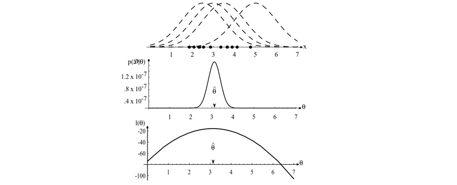

# برآورد بیشترین درست‌نمایی (MLE)

**محمود امین‌طوسی، پاییز ۱۴۰۵**

گروه علوم کامپیوتر، دانشگاه فردوسی مشهد

تعریف‌ها و شکل این صفحه از فصل 3 کتاب *Pattern Classification* نوشتهٔ دودا، هارت و استورک
({cite}`Duda2000`) گرفته شده است. برآوردهایی که اینجا استنتاج می‌شوند همان‌هایی هستند که صفحهٔ
[نظریهٔ تصمیم بیزی](Bayesian-Decision-Theory.ipynb) به کار می‌برد، جایی که چگالی‌های شرطی-دسته
شناخته‌شده فرض می‌شوند.

**هدف‌های یادگیری.** در پایان باید بتوانید

1. درست‌نمایی و لگاریتم درست‌نمایی یک نمونهٔ گاوسی را بنویسید و بگویید چرا لگاریتم می‌گیریم؛
2. برآورد MLE میانگین و واریانس یک گاوسی تک‌متغیره را استنتاج کنید؛
3. برآورد MLE بردار میانگین و ماتریس کوواریانس یک گاوسی چندمتغیره را استنتاج کنید؛
4. بگویید این برآوردها به چه معنا اریب‌دارند و برآورد کوواریانس چه زمانی حتی تعریف نمی‌شود؛
5. توضیح دهید برآوردها چگونه در قاعدهٔ تصمیم بیز جای می‌گیرند و این کار چگونه LDA و QDA می‌دهد.

  <a href="#lang-en">English</a> · <strong>فارسی</strong>

## 1. مقدمه

در دسته‌بندی آماری الگو، فرض رایج این است که داده با توزیع احتمالاتی زیربنایی با پارامترهای ناشناخته
تولید می‌شود. مثلاً شاید فرض کنیم ویژگی $x$ از توزیع گاوسی (نرمال) پیروی می‌کند. برای گرفتن تصمیم
بهینه (مثلاً دسته‌بندی با نظریهٔ تصمیم بیز)، باید پارامترهای این توزیع‌ها را از مجموعه‌دادهٔ آموزش
برآورد کنیم.

**برآورد بیشترین درست‌نمایی (MLE)** روشی پارامتری و استاندارد برای برآورد پارامترهای ناشناختهٔ
$\theta$ در تابع چگالی احتمال $p(x|\theta)$ با داشتن مجموعه‌دادهٔ $\mathcal{D}$ است. اصل کار انتخاب
مقدارهای پارامتری است که دادهٔ مشاهده‌شده را محتمل‌ترین می‌کند.

---

## 2. تابع درست‌نمایی

تابع درست‌نمایی، که با $L(\theta|\mathcal{D})$ نشان داده می‌شود، احتمال مشاهدهٔ مجموعه‌دادهٔ مشخص
$\mathcal{D}$ را به‌عنوان تابعی از پارامترهای $\theta$ نشان می‌دهد.

**تفاوت کلیدی:**
تمایز میان **تابع چگالی احتمال** $p(x|\theta)$ و **تابع درست‌نمایی** $L(\theta|\mathcal{D})$ بنیادی
است:
1.  **$p(x|\theta)$**: توزیع دادهٔ $x$ برای پارامترهای ثابت $\theta$ را توصیف می‌کند.
2.  **$L(\theta|\mathcal{D})$**: احتمال مجموعه‌دادهٔ $\mathcal{D}$ برای دادهٔ مشاهده‌شدهٔ ثابت را،
    به‌عنوان تابعی از $\theta$، توصیف می‌کند.

درست‌نمایی تابعی از $\theta$ است که روی **فضای پارامتر** تعریف می‌شود؛ چگالی تابعی از $x$ است که روی
**فضای ویژگی** تعریف می‌شود. به گفتهٔ دودا، هارت و استورک، شکل تابعی درست‌نمایی لزوماً همان شکل تابعی
چگالی نیست.

**شکل 3.1:** نمودار بالا چند نقطهٔ آموزش در یک بُعد را نشان می‌دهد که معلوم یا فرض شده از گاوسی با
واریانس مشخص ولی میانگین ناشناخته گرفته شده‌اند. چهار توزیع از بی‌نهایت توزیع مبدأ ممکن با خط‌چین
نشان داده شده‌اند. شکل میانی درست‌نمایی $p(\mathcal{D}|\theta)$ را به‌عنوان تابعی از میانگین نشان
می‌دهد. اگر تعداد نقطه‌های آموزش بسیار زیاد بود، این درست‌نمایی بسیار باریک می‌شد. مقداری که
درست‌نمایی را بیشینه می‌کند با $\hat{\theta}$ نشان داده شده؛ همان مقدار لگاریتم درست‌نمایی — یعنی
$\ell(\theta)$ که پایین نشان داده شده — را هم بیشینه می‌کند. به‌ویژه توجه کنید درست‌نمایی در فضایی
متفاوت از $p(x|\hat{\theta})$ قرار دارد و این دو می‌توانند شکل تابعی متفاوت داشته باشند.

---

## 3. استنتاج ریاضی: گاوسی تک‌متغیره

با ساده‌ترین حالت شروع می‌کنیم: برآورد پارامترهای یک توزیع گاوسی تک‌متغیره. این کار بنیاد فهم حالت
چندمتغیره‌ای است که در دسته‌بندی الگو به کار می‌رود.

### 3.1 تعریف مسئله

$\mathcal{D} = \{x_1, x_2, \dots, x_n\}$ مجموعه‌داده‌ای شامل $n$ نمونهٔ مستقل و هم‌توزیع (i.i.d.)
باشد. فرض می‌کنیم هر نمونه از توزیع گاوسی تک‌متغیره گرفته شده است:

$$p(x | \mu, \sigma^2) = \frac{1}{\sqrt{2\pi\sigma^2}} \exp\left(-\frac{(x - \mu)^2}{2\sigma^2}\right)$$

که:
*   $\mu$ میانگین (پارامتر مکان) است.
*   $\sigma^2$ واریانس (پارامتر مقیاس) است.

### 3.2 تابع درست‌نمایی

تابع درست‌نمایی $L(\mu, \sigma^2)$ چگالی احتمال مشترک دادهٔ مشاهده‌شده است، با فرض استقلال:

$$
\begin{aligned}
L(\mu, \sigma^2) &= p(\mathcal{D} | \mu, \sigma^2) \\
&= \prod_{k=1}^n p(x_k | \mu, \sigma^2) \\
&= \prod_{k=1}^n \frac{1}{\sqrt{2\pi\sigma^2}} \exp\left(-\frac{(x_k - \mu)^2}{2\sigma^2}\right) \\
&= \left( \frac{1}{\sqrt{2\pi\sigma^2}} \right)^n \exp\left( -\sum_{k=1}^n \frac{(x_k - \mu)^2}{2\sigma^2} \right)
\end{aligned}
$$

### 3.3 تابع لگاریتم درست‌نمایی

بیشینه کردن مستقیم $L(\mu, \sigma^2)$ به‌دلیل ضرب نمایی‌ها از نظر محاسباتی سخت است. چون لگاریتم
تابعی اکیداً یکنوا است، بیشینه کردن لگاریتم درست‌نمایی $\ell(\mu, \sigma^2)$ همان برآوردهای پارامتری
را می‌دهد که بیشینه کردن درست‌نمایی.

$$
\begin{aligned}
\ell(\mu, \sigma^2) &= \log L(\mu, \sigma^2) \\
&= \sum_{k=1}^n \log \left( \frac{1}{\sqrt{2\pi\sigma^2}} \exp\left(-\frac{(x_k - \mu)^2}{2\sigma^2}\right) \right) \\
&= \sum_{k=1}^n \left[ -\frac{1}{2} \log(2\pi) - \frac{1}{2} \log(\sigma^2) - \frac{(x_k - \mu)^2}{2\sigma^2} \right] \\
&= -\frac{n}{2} \log(2\pi) - \frac{n}{2} \log(\sigma^2) - \frac{1}{2\sigma^2} \sum_{k=1}^n (x_k - \mu)^2
\end{aligned}
$$

### 3.4 برآورد میانگین ($\mu$)

برای یافتن برآورد بیشترین درست‌نمایی $\hat{\mu}$، مشتق جزئی $\ell$ نسبت به $\mu$ را می‌گیریم و صفر
می‌گذاریم:

$$
\frac{\partial \ell}{\partial \mu} = \sum_{k=1}^n \frac{(x_k - \mu)}{\sigma^2} = \frac{1}{\sigma^2} \sum_{k=1}^n (x_k - \mu) = 0
$$

با حل برای $\mu$:

$$
\sum_{k=1}^n x_k - n\hat{\mu} = 0 \implies \hat{\mu} = \frac{1}{n} \sum_{k=1}^n x_k
$$

**نتیجه:** برآورد MLE میانگین همان **میانگین نمونه** است.

### 3.5 برآورد واریانس ($\sigma^2$)

برای یافتن $\hat{\sigma}^2$، مشتق جزئی $\ell$ نسبت به $\sigma^2$ را می‌گیریم. برای مشتق‌گیری
ساده‌تر بگذارید $\tau = \sigma^2$:

$$
\frac{\partial \ell}{\partial \tau} = -\frac{n}{2\tau} + \frac{1}{2\tau^2} \sum_{k=1}^n (x_k - \mu)^2 = 0
$$

با ضرب در $2\tau^2$:

$$
-n\tau + \sum_{k=1}^n (x_k - \mu)^2 = 0
$$

با جای‌گذاری $\hat{\mu}$ به‌جای $\mu$ و $\tau = \sigma^2$:

$$
\hat{\sigma}^2 = \frac{1}{n} \sum_{k=1}^n (x_k - \hat{\mu})^2
$$

**نتیجه:** MLE بر $n$ تقسیم می‌کند، نه بر $n-1$. پس $\hat{\sigma}^2$ نسخهٔ **اریب** واریانس نمونه
است؛ برآوردگر نااریب $s^2 = \frac{1}{n-1}\sum_k (x_k - \hat{\mu})^2$ است (بخش 5).

---

## 4. گسترش به گاوسی چندمتغیره

در دسته‌بندی الگو، ویژگی‌ها معمولاً بردارهای $\mathbf{x} \in \mathbb{R}^d$ هستند. استنتاج
تک‌متغیره طبیعتاً به **توزیع گاوسی چندمتغیره** گسترش می‌یابد.

### 4.1 تابع چگالی

$$p(\mathbf{x} | \boldsymbol{\mu}, \boldsymbol{\Sigma}) = \frac{1}{(2\pi)^{d/2} |\boldsymbol{\Sigma}|^{1/2}} \exp\left( -\frac{1}{2} (\mathbf{x} - \boldsymbol{\mu})^T \boldsymbol{\Sigma}^{-1} (\mathbf{x} - \boldsymbol{\mu}) \right)$$

### 4.2 برآوردهای MLE

لگاریتم درست‌نمایی نسخهٔ برداری بیان بخش 3.3 است:

$$
\ell(\boldsymbol{\mu}, \boldsymbol{\Sigma})
= -\frac{n}{2} \log(2\pi) - \frac{n}{2} \log |\boldsymbol{\Sigma}|
  - \frac{1}{2} \sum_{k=1}^n (\mathbf{x}_k - \boldsymbol{\mu})^T \boldsymbol{\Sigma}^{-1} (\mathbf{x}_k - \boldsymbol{\mu}).
$$

چون $\boldsymbol{\Sigma}$ متقارن است و چون
$\frac{\partial}{\partial \boldsymbol{\mu}} \mathbf{a}^T \mathbf{b} = \mathbf{a}$، دو مشتق چنین‌اند

$$
\frac{\partial \ell}{\partial \boldsymbol{\mu}}
= \sum_{k=1}^n \boldsymbol{\Sigma}^{-1} (\mathbf{x}_k - \boldsymbol{\mu})
= \mathbf{0},
\qquad
\frac{\partial \ell}{\partial \boldsymbol{\Sigma}}
= -\frac{n}{2} \boldsymbol{\Sigma}^{-1}
  + \frac{1}{2} \boldsymbol{\Sigma}^{-1}
    \left[ \sum_{k=1}^n (\mathbf{x}_k - \boldsymbol{\mu})(\mathbf{x}_k - \boldsymbol{\mu})^T \right]
    \boldsymbol{\Sigma}^{-1}
= \mathbf{0}.
$$

معادلهٔ اول بردار میانگین را می‌دهد و جای‌گذاری‌اش در دومی ماتریس کوواریانس را:

1.  **بردار میانگین ($\boldsymbol{\mu}$):**

    $$ \hat{\boldsymbol{\mu}} = \frac{1}{n} \sum_{k=1}^n \mathbf{x}_k $$

    برآورد MLE همان بردار میانگین نمونه است.

2.  **ماتریس کوواریانس ($\boldsymbol{\Sigma}$):**

    $$ \hat{\boldsymbol{\Sigma}} = \frac{1}{n} \sum_{k=1}^n (\mathbf{x}_k - \hat{\boldsymbol{\mu}})(\mathbf{x}_k - \hat{\boldsymbol{\mu}})^T $$

    برآورد MLE همان ماتریس کوواریانس نمونه است، باز هم با مخرج $n$.

### 4.3 وقتی برآورد وجود ندارد

مجموع بالا ماتریسی $d \times d$ است که از $n$ ضرب خارجی ساخته می‌شود، پس
$\operatorname{rank}(\hat{\boldsymbol{\Sigma}}) \leq \min(n, d)$. اگر $n < d$، یا اگر دو ویژگی
دقیقاً هم‌خط باشند، $\hat{\boldsymbol{\Sigma}}$ تکین است و $\hat{\boldsymbol{\Sigma}}^{-1}$ وجود
ندارد: چگالی گاوسی، فاصلهٔ ماهالانوبیس و QDA همه تعریف‌نشده می‌شوند. دو چارهٔ استاندارد هست:

*  نخست بُعد را کم کنید (PCA، گزینش ویژگی)؛
*  برآورد را تنظیم کنید، $\hat{\boldsymbol{\Sigma}} + \lambda \mathbf{I}$ با $\lambda > 0$، که همان
   کاری است «shrinkage» و پیاده‌سازی LDA در Scikit-Learn می‌کنند.

---

## 5. ویژگی‌ها و محدودیت‌ها

هرچند MLE ابزاری توانمند است، دودا، هارت و استورک چند ویژگی مهم این برآوردها را برجسته می‌کنند،
به‌ویژه در بافت دسته‌بندی:

1.  **اریبی:**
    *   برآورد میانگین $\hat{\mu}$ **نااریب** است.
    *   برآورد واریانس $\hat{\sigma}^2$ (و $\hat{\boldsymbol{\Sigma}}$) **اریب** است. به‌طور سیستماتیک
        واریانس واقعی را کم‌برآورد می‌کند چون در مخرج از $n$ به‌جای $n-1$ استفاده می‌کند.
    *   *برآوردگر نااریب:* $s^2 = \frac{1}{n-1} \sum (x_k - \hat{\mu})^2$. ولی برای $n$ بزرگ تفاوت
        ناچیز است.

2.  **سازگاری:**
    *   با رفتن تعداد نمونه‌ها $n \to \infty$، برآوردهای MLE به مقدارهای واقعی پارامتر همگرا می‌شوند.

3.  **ناوردایی:**
    *   اگر $\hat{\theta}$ برآورد MLE برای $\theta$ باشد، آن‌گاه برای هر تابع $g(\theta)$، برآورد
        MLE برای $g(\theta)$ برابر $g(\hat{\theta})$ است.

4.  **حساسیت به داده‌های پرت:**
    *   چون MLE فرض می‌کند داده از توزیع مشخصی (مثلاً گاوسی) پیروی می‌کند، داده‌های پرت می‌توانند
        برآورد میانگین و کوواریانس را به‌شدت کج کنند و کارایی دسته‌بندی را کاهش دهند.

## 6. پیوند با دسته‌بندی بیزی

نقش اصلی MLE در این درس ممکن کردن دسته‌بندی بیزی وقتی پارامترها ناشناخته‌اند است.

### 6.1 رویکرد «جای‌گذاری»

1.  **آموزش:** برای هر دستهٔ $\omega_i$، از دادهٔ آموزش $\mathcal{D}_i$ برآوردهای MLE
    $\hat{\boldsymbol{\mu}}_i$ و $\hat{\boldsymbol{\Sigma}}_i$ را حساب کنید.
2.  **ساخت:** چگالی شرطی-دستهٔ برآوردشده را بسازید:
    $\hat{p}(\mathbf{x} | \omega_i) = \mathcal{N}(\mathbf{x} | \hat{\boldsymbol{\mu}}_i, \hat{\boldsymbol{\Sigma}}_i)$.
3.  **تصمیم:** قاعدهٔ تصمیم بیز را با این چگالی‌های برآوردشده اعمال کنید.

این را **دسته‌بند جای‌گذاری‌شده** (Plug-In Classifier) می‌نامند. با جای‌گذاری بهترین برآورد
پارامترها، دسته‌بند بیز بهینه را تقریب می‌زند.

### 6.2 اثر بر مرزهای تصمیم
برآوردهای MLE هندسهٔ دسته‌بند را تعیین می‌کنند:
*   **تحلیل تفکیک‌گر خطی (LDA):** فرض می‌کند همهٔ دسته‌ها **کوواریانس مشترک** $\boldsymbol{\Sigma}$
    دارند. مرز تصمیم خطی (ابرصفحه) می‌شود.
*   **تحلیل تفکیک‌گر درجه‌دوم (QDA):** فرض می‌کند دسته‌ها **کوواریانس‌های یکتا** $\boldsymbol{\Sigma}_i$
    دارند. مرز تصمیم سطحی درجه‌دوم می‌شود (در دو بُعد بیضی، هذلولی یا سهمی، و در حالت کلی
    ابرسطح درجه‌دوم).

---

## 7. پلی به موضوع‌های پیشرفته

MLE به دسته‌بندی سادهٔ گاوسی محدود نیست. موتور بنیادی بسیاری از مدل‌های پیشرفته‌ای است که بعداً
می‌بینیم:

*   **تحلیل مؤلفه‌های اصلی (PCA):** می‌توان آن را به‌عنوان مسئلهٔ بیشترین درست‌نمایی برای مدلی گاوسی با
    قید (یافتن جهت‌های بیشترین واریانس) استنتاج کرد.
*   **مدل‌های مخلوط گاوسی (GMM):** گاوسی‌های تک‌تایی را به مخلوط‌ها گسترش می‌دهند. از MLE استفاده
    می‌شود، ولی برای حل تکراری به **الگوریتم EM** (امید-بیشینه‌سازی) نیاز دارد.
*   **مدل‌های مارکوف پنهان (HMM):** پارامترها (احتمال‌های گذار و تولید) با MLE و **الگوریتم
    بام-ولش** برآورد می‌شوند؛ گونه‌ای EM که با بازگشت‌های پس‌رو-پیش‌رو شمارش‌های امیدریاضی را حساب
    می‌کند.

---

## 8. جمع‌بندی

روش برآورد بیشترین درست‌نمایی رویکردی اصولی برای یادگیری پارامترهای مدل‌های احتمالاتی در یادگیری
ماشین می‌دهد.

### نکته‌های کلیدی

*   **درست‌نمایی در برابر احتمال:** درست‌نمایی *داده* را به‌شرط *پارامترها* بیشینه می‌کنیم، نه احتمال
    *پارامترها* را به‌شرط *داده*.
*   **لگاریتم درست‌نمایی:** رفتن به دامنهٔ لگاریتمی ضرب‌ها را به جمع تبدیل می‌کند و بهینه‌سازی را
    ساده‌تر.
*   **نتایج تک‌متغیره:**
    *   $\hat{\mu} = \frac{1}{n}\sum_k x_k$، میانگین نمونه (نااریب)؛
    *   $\hat{\sigma}^2 = \frac{1}{n}\sum_k (x_k - \hat{\mu})^2$، برآورد اریب واریانس (واریانس نمونهٔ
        نااریب بر $n-1$ تقسیم می‌کند).
*   **ارتباط با دسته‌بندی:** این برآوردها بلوک‌های سازندهٔ تحلیل تفکیک‌گر خطی (LDA) و دیگر
    دسته‌بندهای گاوسی‌اند که بعداً در درس می‌بینیم.

---

## منابع

{cite}`Duda2000`

Duda, R. O., Hart, P. E., & Stork, D. G. (2000). *Pattern Classification* (2nd ed.).
Wiley-Interscience, chapter 3.
